# Hyrule Pixel

A user-installable GNOME desktop theme inspired by 16/32-bit Zelda-era JRPG pixel art.

## Included

- GNOME Shell stylesheet (GNOME 51 target; live-session validation still required)
- PNG pixel-art frames using 9-slice borders for Shell menus, notifications, buttons, and entries
- Zelda-style inventory details: parchment menu frame, recessed item slots, selected-slot frame, and a faceted green rupee
- GTK 3 light/dark stylesheets and a best-effort GTK 4 stylesheet using the same PNG frame assets
- Pixel-art SVG, 128×128 compatibility PNG, and native 512×512 PNG icon sets for GNOME apps, folders, file types, and system status
- User-local install and uninstall scripts

## Install

Run from the repository root:

```bash
bash scripts/install.sh
```

Enable **Hyrule-Pixel** in GNOME Tweaks under Appearance → Shell (the GNOME User Themes extension is required). Select **Hyrule-Icons** under Icons.

The scripts only write to `$XDG_DATA_HOME` (or `~/.local/share` when unset). They do not modify system directories.

Uninstall:

```bash
bash scripts/uninstall.sh
```

## Screenshots

GitHub Actions installs the theme in a virtual X11 desktop, launches real GTK
demo applications with `GTK_THEME=Hyrule-Pixel`, captures their windows, and
publishes the PNGs here. The workflow can also be started manually from the
repository's **Actions → Capture theme screenshots** page.

### GTK 3

**Widget Factory – page 1**

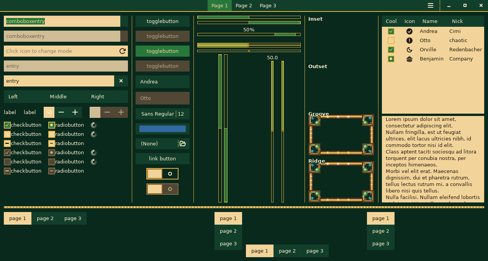

**Widget Factory – page 2**

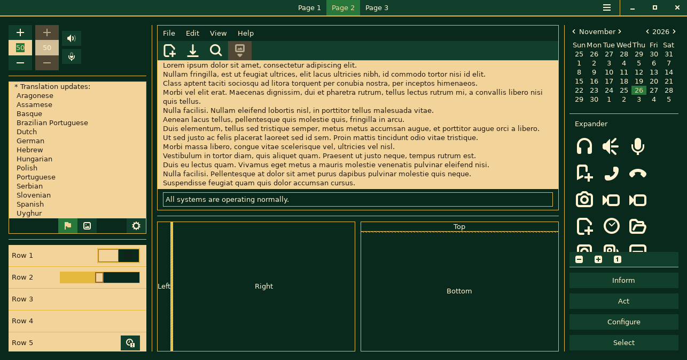

**Widget Factory – page 3**

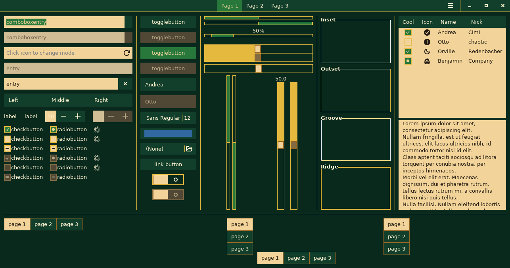

### GTK 4

**GTK Demo – overview**

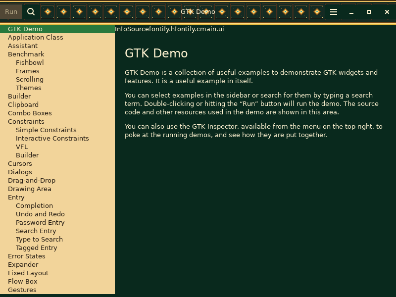

**GTK Demo – themes**

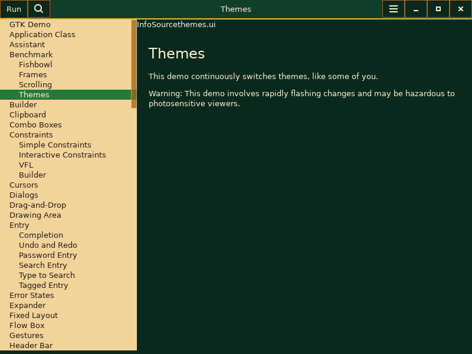

**GTK Demo – frames**

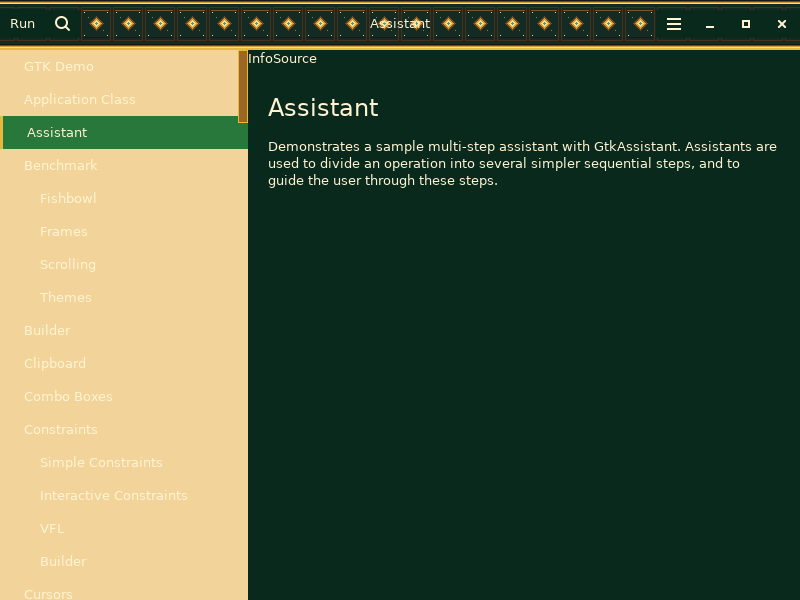

**GTK 4 Widget Factory – controls and inventory-style surfaces**

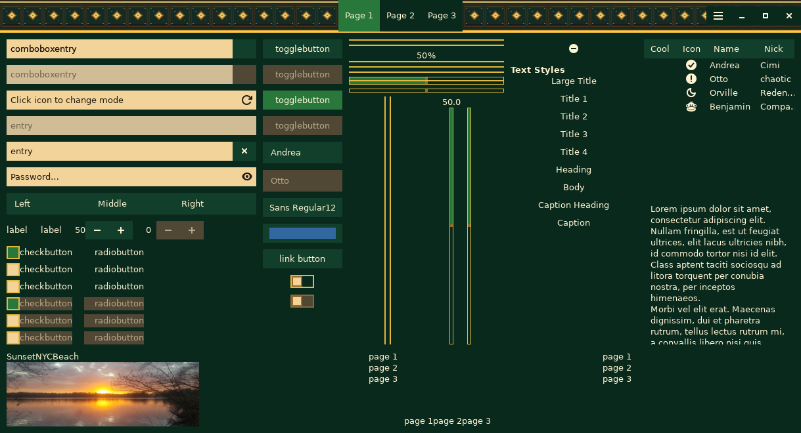

### GNOME Shell 51

A separate Fedora 45 job runs GNOME Shell 51 in a nested Wayland session,
enables the User Themes extension, applies Hyrule-Pixel, and captures the
actual Shell interface. Start it manually from **Actions → Capture GNOME
Shell 51 screenshots**.

**Overview and Dash**

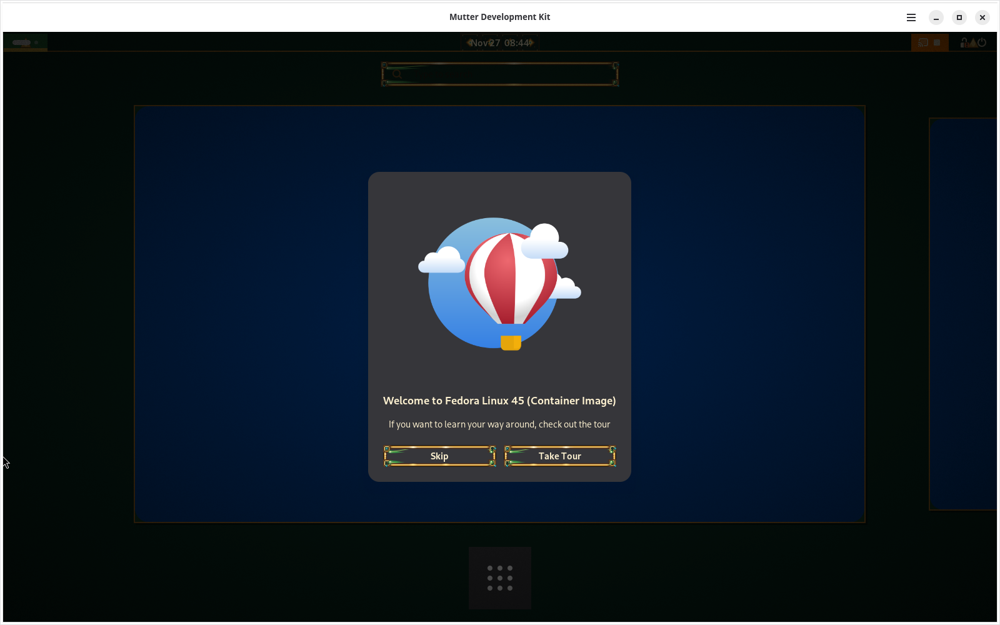

**Calendar**

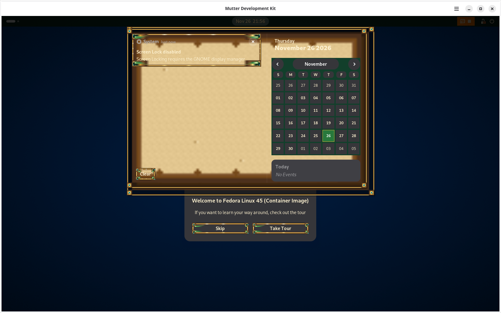

**Quick Settings**

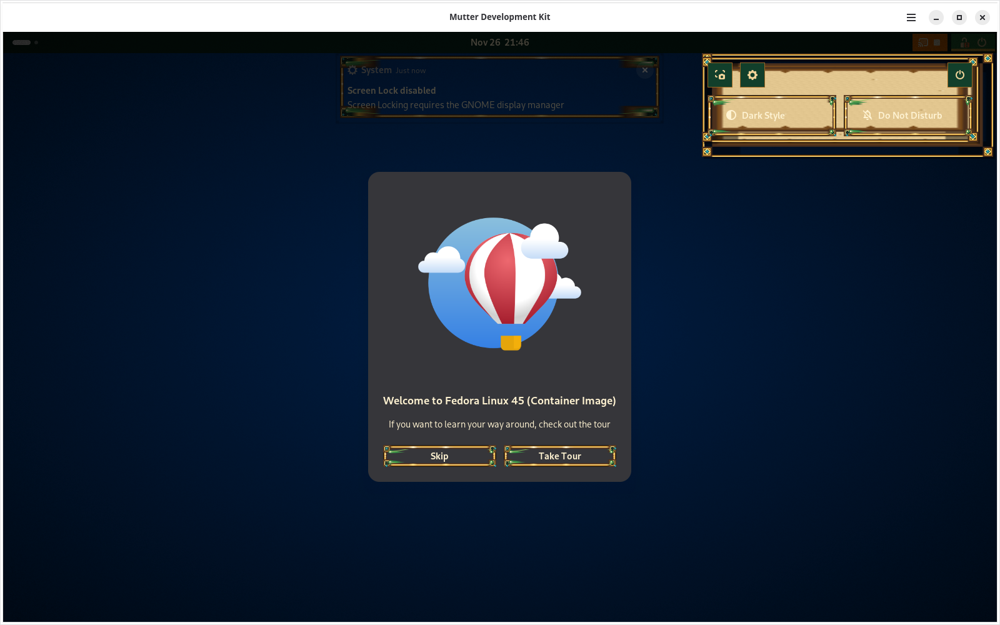

**Notification banner**

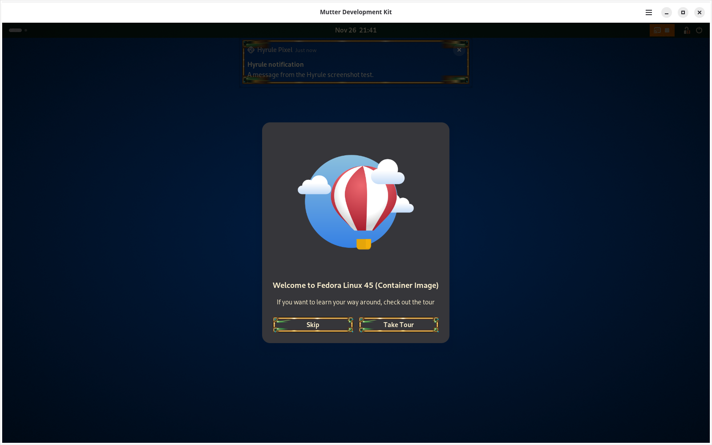

The GTK and Shell screenshots are generated by separate workflows. The Shell
workflow checks that the installed runtime is GNOME Shell 51 before capturing.
The lock screen is not modified by the user-local installer.

## PNG frames and 9-slice rendering

The theme uses small RGBA PNG textures rather than flat CSS borders for its main
panels, buttons, and text entries. The image is divided into four fixed corner
regions and stretchable edge/center regions, so the frame adapts to different
widget sizes without stretching its pixel-art corners.

- `themes/Hyrule-Pixel/assets/panel-frame.png`: 64×64 PNG, 16 px slice
- `themes/Hyrule-Pixel/assets/button-frame.png`: 48×48 PNG, 12 px slice
- `themes/Hyrule-Pixel/assets/entry-frame.png`: 48×48 PNG, 12 px slice
- `themes/Hyrule-Pixel/assets/gold-divider.png`: 32×5 repeatable PNG divider

GNOME Shell St uses its compact `border-image: url(...) top right bottom left`
syntax. GTK uses the standard `border-image: url(...) slice / width stretch`
syntax. These are 9-slice borders, not Android's marker-pixel `.9.png` format.
The PNG files are generated reproducibly by `scripts/draw-theme-textures.py`. The parchment frame is applied to Shell popups. Reusable inventory sprites include normal and selected tabs, a cursor, full/half/empty hearts, green/red/blue rupees, a Triforce emblem, and both item-slot states. All decorative sprites are generated at their intended native pixel dimensions by the same Pillow script and checked by `scripts/check.sh`:

| Sprite | Native size |
| --- | ---: |
| `rupee-green.png`, `rupee-red.png`, `rupee-blue.png` | 24×32 |
| `triforce.png` | 32×30 |
| `heart-red.png`, `heart-half.png`, `heart-empty.png`, `inventory-cursor.png` | 16×16 |
| `inventory-tab.png`, `inventory-tab-selected.png` | 64×24 |
| `inventory-slot.png`, `inventory-slot-selected.png` | 40×40 |

## Compatibility notes

- Target: GNOME Shell 51. The stylesheet is an initial implementation, not a claim of verified GNOME 51 runtime compatibility.
- GTK 4/libadwaita applications may ignore third-party GTK stylesheets.
- GDM and the lock screen are intentionally not modified by the user-local installer.

See [docs/COMPATIBILITY.md](docs/COMPATIBILITY.md) for known limitations.

## AI-generated icon artwork

The 33 native 512×512 PNG icons are generated from individual prompts with
Cloudflare Workers AI using the FLUX.1 Schnell text-to-image model. The pipeline
creates each icon as a separate image, removes the connected chroma-key
background to produce transparent RGBA PNGs, and only downsamples when the
provider returns a larger image. It refuses to upscale undersized images.

### Enable generation in GitHub Actions

1. Create a Cloudflare account and open the Workers AI dashboard.
2. Create a Workers AI API token with **Workers AI Read** and **Workers AI Edit**
   permissions, then copy your Cloudflare Account ID.
3. In the GitHub repository, open **Settings → Secrets and variables → Actions**.
4. Add these repository secrets:
   - `CLOUDFLARE_API_TOKEN`
   - `CLOUDFLARE_ACCOUNT_ID`
5. Run **Actions → Generate Hyrule AI icons → Run workflow**.

Cloudflare Workers AI currently includes 10,000 Neurons per day on its free
allocation. FLUX.1 Schnell is billed in Neurons, so the number of images
available depends on output dimensions and inference steps. Check the current
[Cloudflare pricing](https://developers.cloudflare.com/workers-ai/platform/pricing/)
before generating a full batch. The API token is stored only as a GitHub Actions
secret and is never committed.

To generate locally, install Pillow and export the two environment variables
before running:

```bash
python -m pip install Pillow==11.1.0
export CLOUDFLARE_API_TOKEN="..."
export CLOUDFLARE_ACCOUNT_ID="..."
python scripts/draw-icons.py
bash scripts/check.sh
```

The previous 128×128 compatibility set remains unchanged.

## License

Personal-use project. Artwork and styles in this repository are original project assets; Zelda and related trademarks belong to their respective owners.
